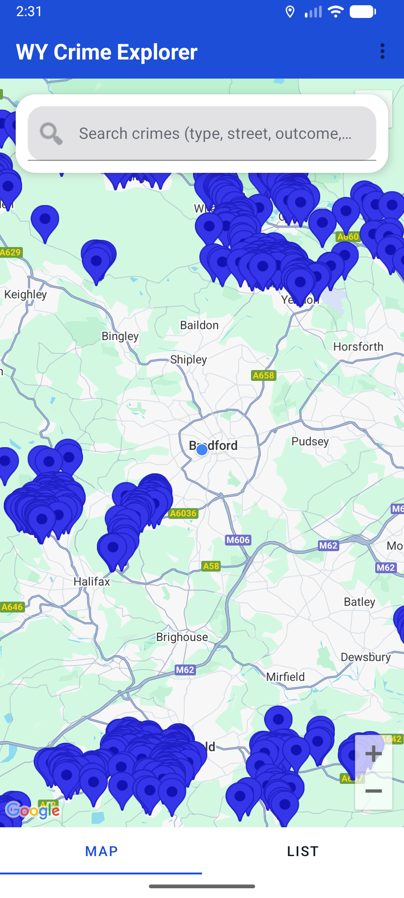
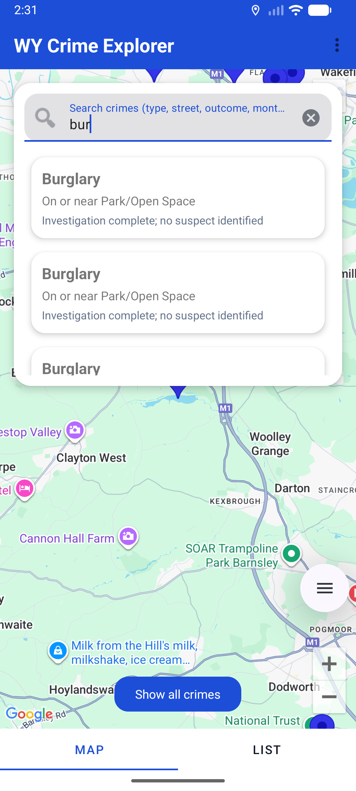
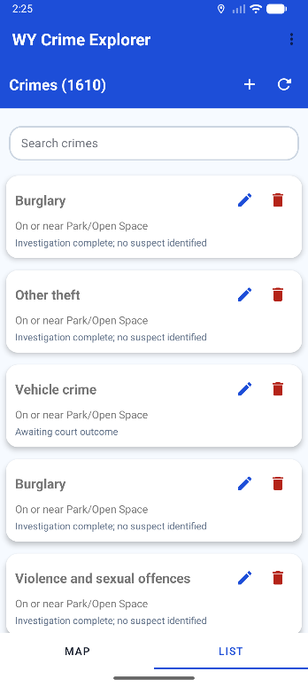
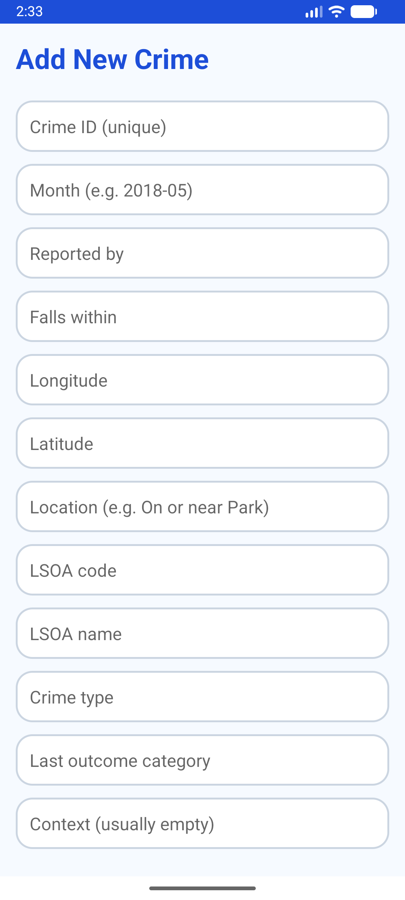

# WY Crime Explorer (Android)

MSc Software Development project, University of Bradford (2026).

An Android app for browsing, searching and managing West Yorkshire crime records on a map. It loads open police data from a bundled CSV into a local database. Users can search and view crimes, and admins can add, edit and delete records.

| Map view | Search | Crime list |
|---|---|---|
|  |  |  |

| Add / edit crime (admin) | Register |
|---|---|
|  |  |

## Features

- **Map view:** crimes plotted on Google Maps, with live search that filters by crime type, street, outcome or month.
- **List view:** scrollable crime cards with edit and delete actions.
- **CRUD:** add, update and delete crime records, restricted to admin users.
- **Accounts:** registration and login with two roles (admin and standard user). Passwords are stored as salted PBKDF2-SHA256 hashes, never in plain text.
- **Offline data:** the crime CSV is imported into a Room (SQLite) database on first launch.

## Architecture

```
app/src/main/java/com/example/wycrimeapp/
├── model/        Room entities: Crime, User
├── controller/   AppDatabase and DAOs (CrimeDao, UserDao)
├── view/         Activities, fragments (Map, List, Search, Admin), RecyclerView adapter
└── util/         PasswordUtils (PBKDF2 hashing), AddressUtils
```

**Tech:** Java, Android SDK (min API 26), Room, Google Maps SDK, Play Services Location, Material Components, RecyclerView, ViewPager, OpenCSV

## Running it

1. Open the project in Android Studio.
2. Get a Google Maps SDK for Android key from the [Google Cloud Console](https://console.cloud.google.com/).
3. Add it to `local.properties` in the project root (this file is git-ignored):
   ```
   MAPS_API_KEY=your_key_here
   ```
4. Build and run on an emulator or a device with API 26 or above.

Crime data: [data.police.uk](https://data.police.uk/), released under the Open Government Licence.
